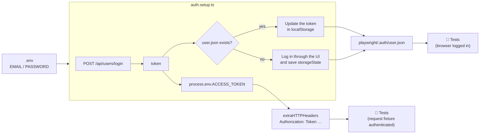

# 🎭 Playwright × APIs: Conduit App


> [!NOTE]
> **Looking for a full API testing framework?** This repo focuses on using APIs to *support UI tests*. For a complete API automation framework, built from a more advanced course and still in progress 🚧, see **[playwright-api-testing](https://github.com/juanpablo-hm/playwright-api-testing)**.

A hands-on project that uses **APIs to make UI tests faster, more stable, and independent**. The tests run against [Conduit](https://conduit.bondaracademy.com/), a Medium-style blogging app, and show how to mock, intercept, and call the backend directly instead of clicking through everything in the UI.

---

## 🧠 What I practiced

| # | Topic | What it covers |
|---|-------|----------------|
| 1 | **Introduction to APIs** | REST basics: methods, status codes, headers, and JSON payloads |
| 2 | **New Playwright Project Setup** | A fresh TypeScript project, config, and projects |
| 3 | **Mocking API Response** | Replacing a real endpoint with fixture data (`route.fulfill`) |
| 4 | **Intercepting & Modifying API Response** | Letting the real call go through, then changing the response before the UI renders it (`route.fetch`) |
| 5 | **Performing API Request** | Creating test data through the API instead of the UI (`request.post`) |
| 6 | **Intercept Browser API Calls** | Capturing a response the browser receives to get dynamic data (`page.waitForResponse`) |
| 7 | **Sharing Authentication State** | Logging in once and reusing the session in every test (`storageState`) |
| 8 | **Authentication using API** | Logging in through the API and adding the token to the saved session |
| ➕ | **Refactor: global token & env variables** | One login for the whole suite, the token sent automatically, and credentials kept out of the code |

---

## 🧪 Test scenarios

### `Mock and Intercept API Call`
- **Mocks** `/api/tags` with local data from [test-data/tags.json](test-data/tags.json).
- **Intercepts** `/api/articles`, rewrites the first article's title and description, and checks that the UI shows the changed values.

### `Delete Article`
- **Creates** an article through the API as a precondition (no UI form).
- Opens it in the browser, deletes it through the UI, and checks that it is gone.

### `Create Article`
- Creates an article through the UI.
- **Captures** the browser's API response to get the article `slug`.
- **Deletes** the article through the API, so cleanup is fast and needs no extra UI steps.

> 💡 Pattern: **set up and clean up through the API, test through the UI.** The UI is only used for what the test is really checking.

---

## 🔐 How authentication works

Authentication runs **once** in a dedicated `setup` project. Every other test starts already logged in.



- **Browser (`page`)**: starts logged in because of `storageState: 'playwright/.auth/user.json'`.
- **API (`request`)**: every call includes `Authorization: Token <token>` through `extraHTTPHeaders` in [playwright.config.ts](playwright.config.ts).
- **Result**: no login code and no repeated headers inside the tests.

---

## 📁 Project structure

```
.
├── tests/
│   ├── auth.setup.ts              # logs in once, shares the token and session
│   └── working-with-apis.spec.ts  # mock, intercept, and API-driven scenarios
├── test-data/
│   └── tags.json                  # mock payload for /api/tags
├── playwright/.auth/user.json     # saved session (gitignored)
├── .env.example                   # template for credentials
└── playwright.config.ts           # projects, storageState, auth headers, dotenv
```

---

## 🚀 Getting started

```bash
# 1. Install dependencies
npm install
npx playwright install chromium

# 2. Set up credentials
cp .env.example .env
# then edit .env with your Conduit account

# 3. Run the tests
npx playwright test

# Open the HTML report
npx playwright show-report
```

> ⚠️ `.env` and `playwright/.auth/` are gitignored, so credentials and session tokens are never committed.

---

## 🛠️ Tech stack

- [Playwright Test](https://playwright.dev/): browser automation and API testing
- TypeScript
- [dotenv](https://github.com/motdotla/dotenv): loads environment variables
